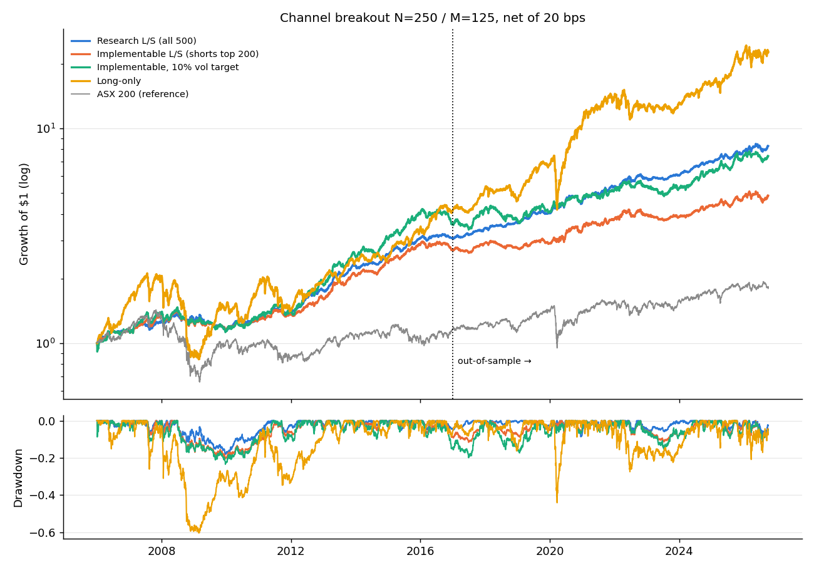
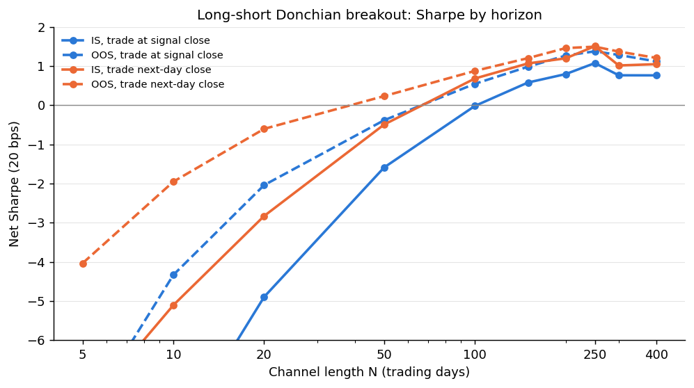
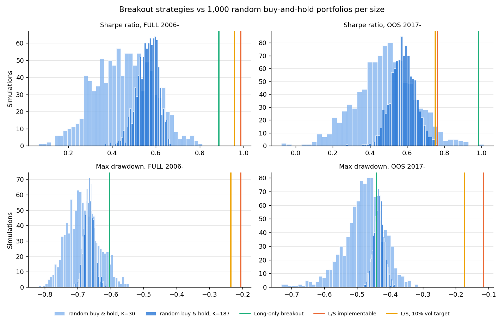
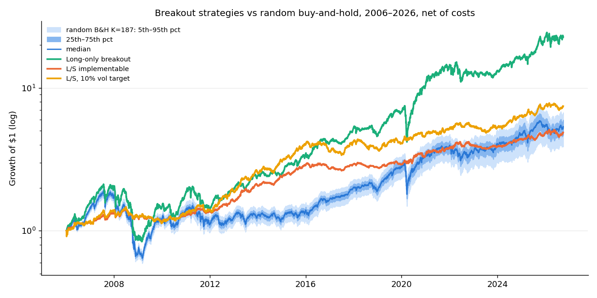

# Channel-Breakout Momentum on the ASX 500

Course project (The Wall Street Quants, *Statistical Arbitrage*): research a profitable
momentum strategy. The brief's crypto universe is swapped for Australian equities here.
The topic is **Donchian channel breakouts** on a point-in-time ASX 500 universe.

## Headline result

A dollar-neutral 250-day Donchian breakout pays off. It enters on a close beyond the 250-day
high or low, exits on a 125-day channel in the other direction, and trades at the next
day's close. It earns about 6–10% a year of alpha with beta near zero, in a 2017–2026
out-of-sample period that played no part in choosing it. Short-horizon breakouts (5–50 days)
lose money because they **reverse**, which is the brief's "short horizon → reversal,
long horizon → momentum" pattern.

| Strategy (net of 20 bps, next-day execution, drifting holdings) | Period | Ann. ret | Ann. vol | Sharpe | Max DD | Alpha vs EW500 (t) | Beta vs ASX200 |
|---|---|---|---|---|---|---|---|
| **Implementable: long ASX 500, short top-200 only** | IS 2006–16 | 9.4% | 7.9% | 1.19 | −20.5% | 9.3% (3.5) | −0.08 |
| | **OOS 2017–26** | **6.3%** | **8.2%** | **0.76** | **−11.5%** | **5.4% (2.2)** | **−0.08** |
| Same, 10% vol target | IS | 12.2% | 10.7% | 1.14 | −23.4% | 12.0% (3.3) | −0.09 |
| | OOS | 7.9% | 10.6% | 0.75 | −17.3% | 6.9% (2.1) | −0.10 |
| Research: long/short across all 500 | IS | 10.5% | 7.0% | 1.51 | −18.2% | 10.1% (4.4) | 0.03 |
| | OOS | 10.3% | 6.9% | 1.50 | −8.6% | 9.2% (4.1) | 0.02 |
| Long-only breakouts | IS | 14.6% | 18.4% | 0.80 | −60.3% | 9.2% (3.8) | 0.71 |
| | OOS | 19.3% | 19.6% | 0.98 | −44.1% | 10.2% (5.4) | 0.93 |
| *Benchmark: equal-weight ASX 500 (drifting)* | IS | 6.0% | 18.3% | 0.33 | −68.3% | — | 0.78 |
| | OOS | 10.1% | 20.7% | 0.49 | −45.8% | — | 1.00 |

Alpha is annualised, from a regression of daily returns on the equal-weight ASX 500 with
Newey-West (10-lag) t-stats. Full tables are in [results/05_final_strategies.csv](results/05_final_strategies.csv).

## Data and universe

* **Prices:** daily OHLCV from Yahoo Finance for all 2,048 currently listed ASX codes,
  2005–2026 ([01_data_and_universe.ipynb](01_data_and_universe.ipynb)). ETFs, LICs and trusts (GICS = "Not Applic") are dropped.
* **Point-in-time ASX 500** ([01_data_and_universe.ipynb](01_data_and_universe.ipynb)): there is no free historical list of
  members, so the universe is rebuilt each month end. It takes the top 500 stocks by 63-day
  median traded value, among stocks priced ≥ $0.10 with at least 252 days of history. It is
  applied from the next trading day.
* **Cleaning:** prices ≤ 0 are removed. Returns are masked for one-day spikes that reverse
  (bad prints), for moves over +400% or under −80%, and for zero-volume days. They are also
  masked where Yahoo's adjustment factor breaks. For example, TAH.AX on 2009-02-10 shows a
  4.5× adjusted move while the raw close fell 6%. That single print was worth +29% in one day
  to an early version of the backtest.
* **Benchmarks:** ASX 200 (^AXJO), plus an equal-weight ASX 500 built the same way as the
  strategy: positions drift with price, joiners enter at the average weight, and leavers exit.
  It carries the same survivorship bias as the strategy, so alpha is measured against it.

## Method

**Signal** ([02_channel_breakout_research.ipynb](02_channel_breakout_research.ipynb), `donchian_state`):

* Long entry: close > highest high of the prior N days. Exit: close < lowest low of the prior M days.
* Short entry: close < lowest low of the prior N days. Exit: close > highest high of the prior M days.
* A position is closed when the stock leaves the universe.

**Portfolio** ([02_channel_breakout_research.ipynb](02_channel_breakout_research.ipynb), `backtest_drift`). This is a holdings-based
version of the course's unconstrained backtest:

* The long side targets +0.5 of capital and the short side −0.5, so gross is 1 and the book
  is dollar neutral.
* A new entry gets an equal share of its side (side gross ÷ number of names on that side).
  The other names on that side are scaled down pro rata to make room.
* Held positions then **drift with price**. They are not reset to equal weight each day.
* Every trade is charged, including the pro-rata scaling.
* Signals from day *t*'s close are traded at day *t+1*'s close (`lag=2`), or at day *t*'s
  close (`lag=1`) as a comparison.

**Why holdings drift.** The first version reset every name to equal weight daily and charged
only for changes in target weights. The Monte Carlo test below showed that this flatters any
equal-weight portfolio on ASX closing prices: random stocks reset daily earn a Sharpe of about
2. The cause is bid-ask bounce and stale closes in small caps, which a daily reset quietly
harvests. The drift engine reproduces a static buy-and-hold portfolio exactly, and all
results here use it.

**Costs:** 20 bps per unit of one-way turnover (market orders), with 7 bps (limit orders)
and 50 bps as sensitivities.

**Discipline:** every design choice (N, M, volume filter, execution lag, vol target) was made
on **2006–2016 only**. 2017–2026 was then run once as the out-of-sample check.

## Findings by research question

### 1. Time horizon: reversal at short horizons, momentum at long ones

| N (days) | 5 | 20 | 50 | 100 | 150 | 200 | **250** | 300 | 400 |
|---|---|---|---|---|---|---|---|---|---|
| IS Sharpe (next-day) | −7.8 | −2.8 | −0.5 | 0.7 | 1.1 | 1.2 | **1.51** | 1.0 | 1.0 |
| OOS Sharpe (next-day) | −4.0 | −0.6 | 0.2 | 0.9 | 1.2 | 1.5 | **1.50** | 1.4 | 1.2 |

* Breakouts over 50 days or less reverse strongly. The −8 Sharpe at N=5 is mostly bid-ask
  bounce: the breakout close is often an ask-side print. This is reversal, but closing prices
  overstate it, so it is not a free strategy to run in the opposite direction.
* Trading one day **later** is better at every horizon (see the lag-1 vs lag-2 lines). This
  is an execution finding: do not buy on the breakout close. Wait a day, or work a limit order.
* Performance is broadly flat from N=150 to N=400, so N=250 is not a knife-edge choice.
* Exit channel ([results/03_exit_grid_IS.csv](results/03_exit_grid_IS.csv)): an exit at half
  the entry window (M = N/2) beat M = N/4 and M = N on IS.

### 2. New information / activity: volume confirmation does not help
| Entries kept | IS Sharpe | OOS Sharpe | OOS alpha (t) |
|---|---|---|---|
| All | **1.51** | **1.50** | 9.2% (4.1) |
| High-volume only (>1.5× avg) | 1.46 | 1.49 | 9.7% (4.1) |
| Low-volume only | 1.40 | 1.34 | 8.8% (3.8) |

High-volume breakouts beat low-volume ones, which is the direction the brief predicts. They
do not beat taking every breakout, however, so the filter is **not** used in the final
strategy. Under the earlier daily-reset backtest the filter looked mildly helpful; that
advantage disappeared once holdings were allowed to drift.

### 3. Weighting: vol targeting
Scaling the book to a 10% annualised vol target leaves Sharpe roughly the same. The target
uses trailing 63-day realised vol, known at *t*, capped at 3× leverage. Returns rise roughly
in proportion to the extra risk, so its use is risk control, not added edge.

### 4. Execution / costs ([results/06_costs.csv](results/06_costs.csv))
Turnover is about 3% of gross a day, because the 250-day channel trades rarely.

| Cost per trade | OOS Sharpe (next-day) | OOS alpha (t) |
|---|---|---|
| 0 bps | 0.93 | 6.8% (2.7) |
| 7 bps (limit) | 0.87 | 6.3% (2.5) |
| 20 bps (market) | 0.76 | 5.4% (2.2) |
| 50 bps (stress) | 0.51 | 3.2% (1.3) |

### 5. Where the money comes from ([results/07_yearly.csv](results/07_yearly.csv))
The implementable L/S book is positive in 15 of 20 full years (2006–2025). The losing years
are 2008 (−7%), 2009 (−6%), 2016 (−5%), 2018 (−5%) and 2023 (−2%).
2009 is the textbook **momentum crash**: the short leg lost 28% as beaten-down stocks
rebounded, which the long leg partly offset. The long leg drives most returns in trending
bull years. The short leg pays in bear years (2008, 2011, 2014, 2022), so the two legs
diversify each other.

## Monte Carlo: strategy vs random buy-and-hold ([02_channel_breakout_research.ipynb](02_channel_breakout_research.ipynb), section 12)

**Setup.** Each simulation picks K stocks at random from the ASX 500 on the start date,
buys them equal weight (paying 20 bps once), and holds them to the end with no rebalancing.
There are 1,000 simulations for each K: K=30, a typical concentrated investor, and K=187,
the breakout strategy's average number of longs. Two windows are run, 2006–2026 and
2017–2026. Like the strategy, random picks are drawn only from stocks still listed in 2026,
so both carry the same survivorship bias.

| OOS 2017–26 | CAGR | Sharpe | Max DD | Alpha vs ASX200 |
|---|---|---|---|---|
| Random B&H K=187, median (5th–95th pct) | 8.9% (6.8–11.0) | 0.58 (0.47–0.68) | −43% (−46 to −41) | 5.0% |
| Long-only breakout | **18.9%** (100th pct) | **0.98** (100th) | −44% (33rd) | 14.1% (100th) |
| L/S breakout, implementable | 6.1% (1st) | **0.76** (100th) | **−11.5%** (100th) | 6.7% (94th) |
| L/S breakout, 10% vol target | 7.7% (15th) | **0.75** (100th) | −17.3% (100th) | 8.5% (100th) |

Percentiles show where each strategy falls within the 1,000 random portfolios.
Full-sample and K=30 results are in [results/10_mc_buyhold.csv](results/10_mc_buyhold.csv).

* **Long-only breakout** beats all 1,000 random portfolios of the same size on return,
  Sharpe and alpha, in both windows. It does not reduce crash risk: its OOS drawdown sits
  mid-pack. It is a better stock picker, not a safer one.
* **L/S breakout** does not out-earn buy-and-hold in raw return; it sits at the 1st–30th
  percentile on CAGR. It runs at about 8% vol against 17% for buy-and-hold, however, so it
  beats every random portfolio on Sharpe and drawdown. Its −11.5% OOS drawdown compares with
  −41% to −46% for buy-and-hold.
* **Control.** The same random picks reset to equal weight every day show a median CAGR of
  31% and a Sharpe of 2.0 over 2006–2026. Random selection has no skill, so that figure is
  the size of the daily-reset artifact, and it is why the backtests use drifting holdings.

## Statistical significance ([notebook 02](02_channel_breakout_research.ipynb), section 13)

| Test (p-value; < 0.05 = significant) | Long-only | L/S implementable |
|---|---|---|
| Monte Carlo: Sharpe beats random buy-and-hold (OOS) | 0.001 | 0.001 |
| Timing permutation: shuffled signal timing does as well (full) | 0.015 | 0.005 |
| Paired block bootstrap: ΔSharpe vs random buy-and-hold (OOS) | 0.001 | 0.68 |
| Paired block bootstrap: Δreturn vs random buy-and-hold (OOS) | 0.001 | 0.54 |
| OOS Sharpe > 0 (probabilistic Sharpe ratio) | 0.001 | 0.009 |

* **Long-only** breakouts are significantly better than random buy-and-hold under every test.
* **L/S:** breakout timing is significant and its alpha is significant. Its Sharpe *advantage* over buy-and-hold, however, is not significant once time-sampling noise is included (bootstrap); with 9–20 years of data, two Sharpe ratios are hard to tell apart.
* **Deflated Sharpe** (correcting for about 35 in-sample trials): the in-sample result is borderline (0.96 counting plausible trials; it fails if the dead short-horizon trials are counted). The once-only out-of-sample test is the real evidence.

## Removing beta ([notebook 02](02_channel_breakout_research.ipynb), section 14)

| OOS 2017–26 | Sharpe | Max DD | Alpha (t) | Beta vs ASX200 |
|---|---|---|---|---|
| Long-only, unhedged | 0.98 | −44% | 10.2% (5.4) | 0.93 |
| **Long-only, hedged with ASX 200 (rolling beta)** | **1.03** | **−19%** | 10.3% (3.2) | −0.02 |
| L/S implementable (single-stock shorts) | 0.76 | −12% | 5.4% (2.2) | −0.08 |

* **Portfolio-level hedge (the WSQ regression approach): worthwhile.** Shorting index futures against the long book gives a market-neutral strategy without shorting small caps. It had the best out-of-sample Sharpe of the neutral books. It does not protect against a small-cap crash: its 2008 drawdown was still −43%.
* **Signal-level (residual breakouts): not worthwhile here.** Breakouts on beta-adjusted prices were worse in- and out-of-sample for the L/S books, and lost more in 2009.

## Robustness checks

* **Size control** ([results/09_size_control.csv](results/09_size_control.csv)): the
  implementable book is long small caps and short large caps, so part of its return could
  be a size tilt. With a second factor (EW ASX 500 − EW top 200) in the regression, alpha
  stays at **9.7% (t 3.6) IS and 6.1% (t 2.6) OOS**.
* **Multiple testing:** about 80 configurations were tried on IS. The chosen one was then
  confirmed OOS, and its neighbours (N=150–400) perform similarly. That makes a pure
  data-mining explanation unlikely.

## Caveats (read before trusting the numbers)

1. **Survivorship bias.** The ticker list is today's listings, so stocks that delisted before
   2026 are missing. This is the reason the pre-2017 universe holds 390–490 names rather than
   500. Missing failures would mainly have paid the *short* leg, which understates it.
   Missing takeover targets would mainly have paid the *long* leg. Measuring alpha against
   the equal-weight universe, which carries the same bias, removes the common component.
   A clean test needs a delisted-inclusive database (e.g. Norgate, Refinitiv).
2. **Shorting constraints.** ASX short selling is limited to approved, liquid securities,
   and borrow costs are not modelled. The "implementable" version limits shorts to the top
   200 for this reason. The all-500 short book is a research construct, and the gap between
   the two (OOS Sharpe 1.50 vs 0.76) shows how much of the edge sits in hard-to-short names.
3. **Capacity.** The median held name trades A$0.1–0.8m a day before 2019 and A$1.5–5.6m
   since. This strategy suits small capital. 20 bps is optimistic for the smallest names;
   at 50 bps the OOS alpha is no longer significant (t 1.3).
4. **Weighting.** There are no per-name, sector or liquidity caps, and each side gets 50% of
   capital even when it holds few names.
5. **Yahoo data quality.** Several adjustment errors were found and filtered (see Data). More
   may remain undetected.

## Next steps

* Rerun on survivorship-free data with delisting returns.
* Add a momentum-crash guard, for example scaling down the short leg after sharp market
  rebounds (Daniel & Moskowitz).
* Add per-name caps and liquidity-scaled weights.
* Run a matched-random-entry null for the L/S book. This would shift each stock's signal
  in time, keeping its trade count and holding periods, and is a tighter test than
  buy-and-hold.

## Crash-only shorts ([03_crash_regime_shorts.ipynb](03_crash_regime_shorts.ipynb))

Long-only breakouts with a short leg (index hedge or breakdown-stock shorts) switched on only when
a market-crash signal fires (ASX 200 below its 200-day average, 10%/20% drawdown, or a volatility
spike). The rule is chosen on 2006–16 in-sample Calmar; COVID and 2022 are out-of-sample.

| OOS 2017–26 | Sharpe | Max DD | Calmar |
|---|---|---|---|
| Long-only | 0.98 | −44% | 0.44 |
| Crash-only stock shorts (chosen: 200-day signal) | 0.79 | −33% | 0.42 |
| Always index-hedged | 1.04 | −19% | 0.76 |

* Crash-only shorting cut the crash losses themselves (COVID −13% vs −44%), even out-of-sample.
* The signal was too slow to switch off, so the shorts were caught in the 2009 and 2020 rebounds,
  and the 200-day rule whipsawed in 2022–23. Net, it was no better than long-only on Calmar.
* The always-on ASX 200 futures hedge was the best risk-adjusted option out-of-sample.

## Out-of-market test: US equities ([us_sp1500/](us_sp1500/))

The ASX rule (N=250, M=125, next-day execution, 20 bps) was applied **unchanged** to an
S&P 1500-style US universe: the top 1,500 by traded value from current S&P 500/400/600 members
plus removed members that still have data.

| Market-neutral L/S book | Sharpe IS 2006–16 | Sharpe OOS 2017–26 | Alpha OOS (t) |
|---|---|---|---|
| ASX 500 | 1.51 | 1.50 | 9.2% (4.1) |
| US S&P 1500-style | −0.57 | −0.01 | 0.9% (0.4) |

* **The edge does not carry over.** US long-horizon breakouts earn nothing market-neutral, the
  long-only book just tracks the market, and the short leg lost money in most years of the US
  bull market.
* **The market is the reason, not the rule.** Classic 12-1 decile momentum on the same US data
  had a Sharpe of −0.2 in 2006–16 and +0.3 in 2017–26, against +0.6 and +1.1 on the ASX.
  US momentum was weak over this period; Australian momentum was strong.
* **What does carry over:** short horizons reverse in both markets.

## Out-of-market test: Nasdaq ([nasdaq/](nasdaq/))

The same unchanged rule on the 1,000 most-traded Nasdaq-listed common stocks each month, built
like the ASX universe (all current listings ranked by traded value):

| Market-neutral L/S book | Sharpe IS 2006–16 | Sharpe OOS 2017–26 | Alpha OOS (t) |
|---|---|---|---|
| ASX 500 | 1.51 | 1.50 | 9.2% (4.1) |
| Nasdaq top 1,000 | −0.06 | 0.32 | 3.1% (1.2) |
| US S&P 1500-style | −0.57 | −0.01 | 0.9% (0.4) |

* **Nasdaq sits between the two, much closer to the S&P 1500.** The post-2016 improvement
  matches a US-wide momentum revival: classic 12-1 momentum on Nasdaq had a Sharpe of −0.02
  in 2006–16 and 0.66 in 2017–26.
* **Benchmark choice matters in a mega-cap era.** Long-only breakouts beat the equal-weight
  universe but trail the cap-weighted Nasdaq Composite, and a Nasdaq-100 hedge lost money
  because it shorted the market leaders.
* **The ASX remains the outlier:** only there is the breakout edge strong and significant.

## Reproduce

Run the notebooks in order:

1. `01_data_and_universe.ipynb`: downloads ~2,050 tickers and benchmarks (~10 min the first
   time, cached in `data/`), cleans returns, builds the point-in-time universe and writes
   `data/clean.pkl`.
2. `02_channel_breakout_research.ipynb`: signal, backtest engine, all research sections and
   the Monte Carlo. Writes tables `01`–`10` and the charts to `results/` (~2.5 min).

The original script versions are kept in `archive_py/` for reference. They produce the same
results but are no longer maintained.
