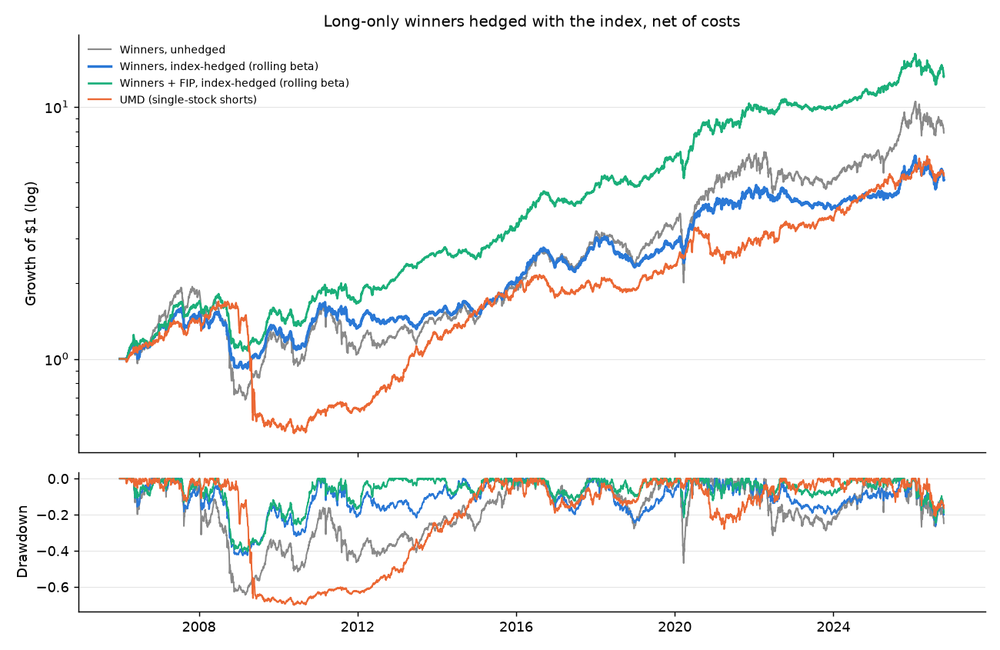
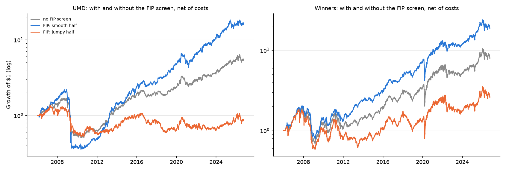

# UMD Momentum on the ASX 500, Rebalanced Quarterly

Course project (The Wall Street Quants, *Statistical Arbitrage*): research a momentum
strategy. The brief's crypto universe is swapped for Australian equities here.
The topic is **UMD ("up minus down")**, the standard momentum factor: buy the stocks that
rose most over the past year, short the ones that fell most. It is rebalanced every quarter,
and tested with a **FIP ("frog in the pan") quality screen** and as a **long-only book hedged
with index futures**.

Earlier studies are archived: the Donchian channel breakout in
[archive_donchian/](archive_donchian/) and the 200-day moving-average crossover in
[archive_ma_crossover/](archive_ma_crossover/).

## Headline results

Every figure is for 2006–2026, net of Interactive Brokers costs (0.08% commission plus half a
one-tick bid-ask spread on every trade) and a 1% a year borrow fee on shorts.

| Net of costs, quarterly rebalance | Ann. ret | Ann. vol | Sharpe | Max DD | Alpha vs All Ords (t) | Beta |
|---|---|---|---|---|---|---|
| UMD (winners minus losers) | 9.3% | 16.0% | 0.58 | −70% | 9.0% (2.4) | 0.06 |
| UMD + FIP screen | 15.5% | 20.9% | 0.74 | −84% | 15.7% (3.0) | −0.05 |
| Winners, long-only, unhedged | 11.9% | 20.1% | 0.59 | −64% | 8.2% (2.4) | 0.88 |
| Winners, hedged with the index | 8.8% | 13.8% | 0.64 | −43% | 8.8% (2.6) | −0.01 |
| **Winners + FIP, hedged with the index** | **13.2%** | **13.2%** | **1.00** | **−41%** | **13.3% (4.2)** | **−0.01** |
| *Benchmark: equal-weight ASX 500* | 6.1% | 15.9% | 0.38 | −64% | — | 0.78 |
| *Benchmark: All Ordinaries (price index)* | 4.3% | 16.2% | 0.27 | −55% | — | 1 |

## How the portfolio is built

On the last trading day of **February, May, August and November** (so the book is in place
before each quarter-ending month), among ASX 500 members with a year of prices:

1. **Momentum** = return over the previous 12 months, skipping the most recent month.
2. **Size split:** members above the median traded value are *big*, the rest *small*.
3. **Within each half:** the top 30% by momentum are winners, the bottom 30% losers.
4. **UMD = ½ (big winners + small winners) − ½ (big losers + small losers)**: $1 long and $1
   short per $1 of capital, about 138 stocks a side.

Trades are made at the next day's close, and positions drift until the next rebalance.

**Two departures from the textbook factor, both forced by the data.** There is no market-cap
history, so the size split uses traded value and stocks are equal-weighted within each
portfolio. The textbook factor is also rebalanced monthly.

## FIP screen: the quality of the momentum

Da, Gurun & Warachka (2014) argue that investors under-react to a long run of small gains
but notice a big jump, so momentum built smoothly lasts longer. Over the same 12-1 month
window:

> FIP = sign(past return) × (% of days down − % of days up)

A low score means the move was made on many small days. After the winners and losers are
picked, the screen keeps the **smoother half** of each (about 69 names a side), following
Gray & Vogel's *Quantitative Momentum*.

| After costs, 2006–2026 | No screen | Smooth half | Jumpy half |
|---|---|---|---|
| UMD: return a year (Sharpe) | 9.3% (0.58) | **15.5% (0.74)** | 1.1% (0.06) |
| Winners: return a year (Sharpe) | 11.9% (0.59) | **15.8% (0.83)** | 7.3% (0.31) |
| Winners: alpha vs EW ASX 500 (t) | 4.8% (2.7) | **9.5% (4.4)** | −0.6% (−0.3) |
| Losers held long: return a year | −4.9% | **−9.8%** | −0.8% |

* The ordering is what the idea predicts on both sides: smooth beats no screen, which beats
  jumpy. The jumpy winners have no edge over the market at all.
* The gains are statistically reliable: smooth minus no-screen is +3.9% a year for winners
  (t = 2.5) and +6.2% for UMD (t = 2.3).
* The cost: half as many names, more turnover, and for UMD a deeper 2009 loss.

## Long-only winners hedged with index futures

Hold only the winners and short the index against them in proportion to the book's rolling
126-day beta. No individual stock is shorted.

* **Hedging removes the market and keeps the alpha:** beta falls from 0.88 to zero,
  volatility from 20% to 14%, and the alpha stays at 8.8% a year.
* **It avoids the momentum crash.** In 2009 UMD lost 64% as the losers it was short
  rebounded 152%. The hedged winners made +36%.
* **Its bad year is 2008 (−38%):** smaller winners fell much further than the large-cap
  index used to hedge them.
* **With the FIP screen** the hedged book has a Sharpe of 1.0 and is significant in each
  half of the sample (t = 3.1 and 2.9).
* The All Ords price index stands in for SPI 200 futures; dividends, interest, roll and
  margin are ignored.

## Other findings

* **Both sides of UMD pay.** Winners beat the equal-weight ASX 500 by 5.9% a year (t = 3.2);
  losers lose 4.9% a year in a market that gains 6.1%.
* **Rebalancing before quarter-ending months made no difference.** Feb/May/Aug/Nov gives a
  Sharpe of 0.58; calendar quarter-ends give 0.62.
* **Frequency:** monthly rebalancing earns more before costs (Sharpe 1.15 against 0.89) but
  trades almost twice as much; after costs it is level with quarterly. Half-yearly (0.48) and
  yearly (0.18) are worse.
* **Costs take a third of UMD's return:** 4.7% a year of 14.0%, mostly bid-ask spread. The
  winners-only books cost about 1.9% a year.
* **Account size:** about 370 orders per rebalance, so IBKR's A$6 minimum costs about A$8,800
  a year. Negligible on A$1m or more.
* **It is momentum that earns it.** UMD with momentum scores shuffled loses money in all 200
  trials.
* **A narrow book is dangerous.** With only the top and bottom 10%, UMD lost more than its
  whole capital in the 2009 rebound.

## Caveats (read before trusting the numbers)

1. **Capacity is small.** The median holding traded under A$0.1m a day until 2017, on the
   long side as well as the short side.
2. **Single-stock shorts may not be possible** for half the losers. The hedged long-only
   book avoids that.
3. **Survivorship bias.** Only today's listed companies are included, which flatters the
   winners and understates the short side.
4. **FIP is one more choice made on the same data.** It was applied once, as published, but
   its effect should be confirmed in another market or period.
5. **Not the textbook factor exactly:** equal weights and a traded-value size split.
6. **Spread and borrow assumptions** (one tick; 1% a year) are optimistic for thin names.
7. **Yahoo data quality.** Errors were filtered in notebook 01, but some may remain.

## Next steps

* Test the FIP screen on the US universes already downloaded.
* Add a liquidity floor and see how much of the hedged-winners result survives.
* A crash guard for the UMD short side; survivorship-free data.

## Data and universe

Built by [01_data_and_universe.ipynb](01_data_and_universe.ipynb): daily Yahoo prices for
ASX-listed companies (2005–2026), cleaned for bad prints and adjustment errors, and a
point-in-time ASX 500 rebuilt each month as the top 500 stocks by 63-day median traded value.

## Report

[UMD_Momentum_Report.docx](UMD_Momentum_Report.docx) is the write-up skeleton: section headings,
table shells and grey guidance notes pointing to the notebook sections and result files.

## Reproduce

1. `01_data_and_universe.ipynb`: downloads and cleans prices, builds the universe, writes
   `data/clean.pkl`.
2. `02_umd_momentum_research.ipynb`: the full analysis (about 6 minutes). Writes tables and
   charts to `results/`.

`us_sp1500/` and `nasdaq/` hold the data-preparation notebooks for the US universes used by
the archived Donchian study.
