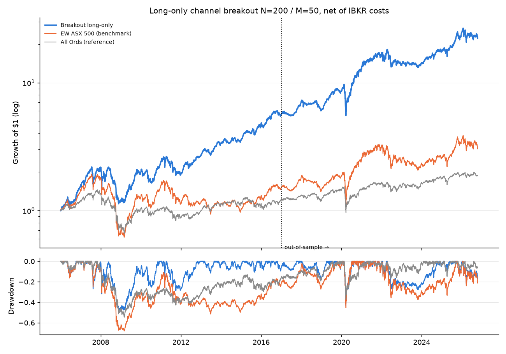
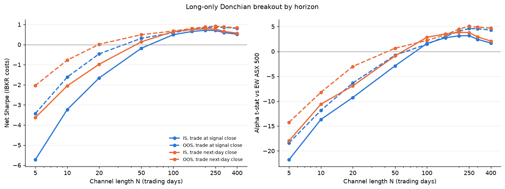
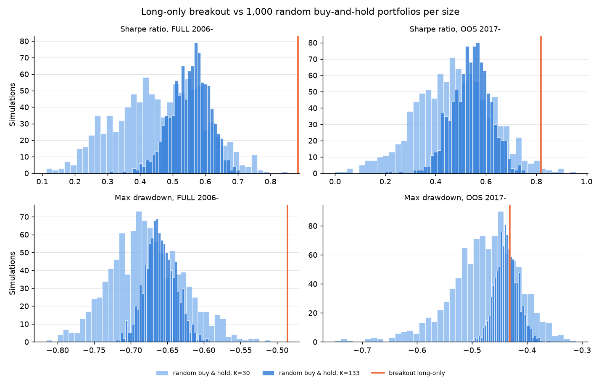
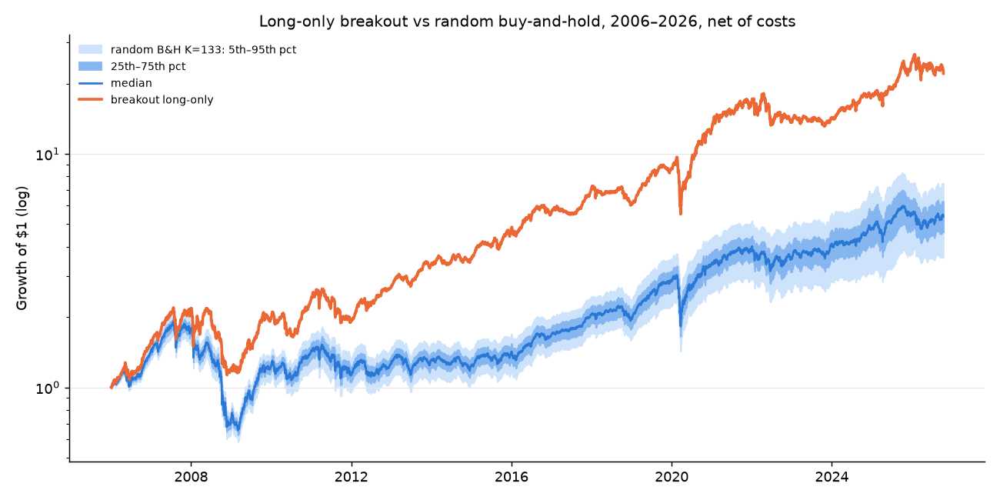

# Channel-Breakout Momentum on the ASX 500

Course project (The Wall Street Quants, *Statistical Arbitrage*): research a profitable
momentum strategy. The brief's crypto universe is swapped for Australian equities here.
The topic is **Donchian channel breakouts** on a point-in-time ASX 500 universe, traded
**long-only across all 500 names**.

## Headline result

A long-only 200-day Donchian breakout pays off. It buys on a close above the 200-day high,
sells on a close below the 50-day low, and trades at the next day's close. Every new
breakout gets an equal share of capital. After Interactive Brokers costs it earns 15.7% a
year in a 2017–2026 out-of-sample period that played no part in choosing it, with alpha of
7.8% a year over the equal-weight ASX 500. Short-horizon breakouts (5–20 days) lose money
because they **reverse**, which is the brief's "short horizon → reversal, long horizon →
momentum" pattern.

| Net of IBKR costs, next-day execution, drifting holdings | Period | Ann. ret | Ann. vol | Sharpe | Max DD | Alpha vs EW500 (t) | Beta vs All Ords |
|---|---|---|---|---|---|---|---|
| **Long-only breakout (N=200, M=50)** | IS 2006–16 | 17.4% | 18.4% | 0.95 | −48.6% | 12.7% (4.4) | 0.72 |
| | **OOS 2017–26** | **15.7%** | **19.2%** | **0.82** | **−43.1%** | **7.8% (3.2)** | **0.92** |
| Same, hedged with the index (rolling beta) | IS | 16.0% | 13.0% | 1.23 | −32.3% | 14.5% (4.2) | −0.03 |
| | OOS | 10.8% | 13.4% | 0.80 | −20.3% | 7.8% (2.3) | −0.02 |
| *Benchmark: equal-weight ASX 500 (drifting)* | IS | 5.4% | 18.3% | 0.30 | −68.0% | — | 0.83 |
| | OOS | 9.2% | 20.3% | 0.45 | −45.3% | — | 1.04 |
| *Benchmark: All Ordinaries (price index)* | IS | 3.3% | 17.5% | 0.19 | −54.6% | — | 1 |
| | OOS | 5.5% | 14.6% | 0.37 | −37.1% | — | 1 |

**Every return and Sharpe ratio is net of transaction costs**: IBKR's 0.08% commission plus
half a one-tick bid-ask spread on every trade. Alpha is annualised, from a regression of
daily returns on the equal-weight ASX 500 with Newey-West (10-lag) t-stats. Full tables are
in [results/long_only/05_final_strategies.csv](results/long_only/05_final_strategies.csv).

**No value-weighted version.** Only equal-weighted entries are tested. Value weighting needs
each stock's market capitalisation through time, and the data does not have it: Yahoo's
price history carries no share counts, and its separate shares-outstanding history only
begins around 2015–2017 for most ASX stocks. Filling the earlier years with later share
counts gives badly wrong weights for small caps that issued a lot of stock, so the
comparison was left out.

**Earlier long/short version.** Notebook 02 previously studied a dollar-neutral long/short
book (N=250, M=125, flat 20 bps). Its result files are still in [results/](results/), and
the crash-shorts and out-of-market sections further down refer to it.

## Data and universe

* **Prices:** daily OHLCV from Yahoo Finance for all 2,048 currently listed ASX codes,
  2005–2026 ([01_data_and_universe.ipynb](01_data_and_universe.ipynb)). ETFs, LICs and trusts (GICS = "Not Applic") are dropped.
* **Point-in-time ASX 500** ([01_data_and_universe.ipynb](01_data_and_universe.ipynb)): there is no free historical list of
  members, so the universe is rebuilt each month end. It takes the top 500 stocks by 63-day
  median traded value, among stocks priced ≥ $0.10 with at least 252 days of history. It is
  applied from the next trading day.
* **Cleaning:** prices ≤ 0 are removed. Returns are masked for one-day spikes that reverse
  (bad prints), for moves over +400% or under −80%, and for zero-volume days. They are also
  masked where Yahoo's adjustment factor breaks. For example, TAH.AX on 2009-02-10 shows a
  4.5× adjusted move while the raw close fell 6%. That single print was worth +29% in one day
  to an early version of the backtest.
* **Benchmarks:** All Ordinaries (^AORD, a price index), plus an equal-weight ASX 500 built the same way as the
  strategy: positions drift with price, joiners enter at the average weight, and leavers exit.
  It carries the same survivorship bias as the strategy, so alpha is measured against it.

## Method

**Signal** ([02_channel_breakout_research.ipynb](02_channel_breakout_research.ipynb), `donchian_long`):

* Entry: close > highest high of the prior N days. Exit: close < lowest low of the prior M days.
* A position is closed when the stock leaves the universe.

**Portfolio** ([02_channel_breakout_research.ipynb](02_channel_breakout_research.ipynb), `backtest_drift`). This is a holdings-based
version of the course's unconstrained backtest:

* Long-only and fully invested: the names with a live breakout share 100% of capital.
* A new entry gets an equal share (1 ÷ number of names held). The names already held are
  scaled down pro rata to make room.
* Held positions then **drift with price**. They are not reset to equal weight each day.
* Every trade is charged, including the pro-rata scaling.
* Signals from day *t*'s close are traded at day *t+1*'s close (`lag=2`), or at day *t*'s
  close (`lag=1`) as a comparison.

**Why holdings drift.** The first version reset every name to equal weight daily and charged
only for changes in target weights. The Monte Carlo test below showed that this flatters any
equal-weight portfolio on ASX closing prices: random stocks reset daily earn a Sharpe of about
1.5. The cause is bid-ask bounce and stale closes in small caps, which a daily reset quietly
harvests. The drift engine reproduces a static buy-and-hold portfolio exactly, and all
results here use it.

**Costs: Interactive Brokers, Australia (fixed pricing).**

* Commission of **0.08% of trade value** on every trade.
* **Half the bid-ask spread**, taken as one ASX tick (0.1c below 10c, 0.5c from 10c to $2,
  1c above). The median held name has a half-spread of 15 bps.
* IBKR's **A$6 minimum per order** depends on account size and is reported separately below.
* A flat 20 bps, the brief's assumption, is kept as a comparison.

**Discipline:** every design choice (N, M, volume filter, execution lag) was made on
**2006–2016 only**. 2017–2026 was then run once as the out-of-sample check.

## Findings by research question

### 1. Time horizon: reversal at short horizons, momentum at long ones

| N (days) | 5 | 20 | 50 | 100 | 150 | **200** | 250 | 300 | 400 |
|---|---|---|---|---|---|---|---|---|---|
| IS Sharpe (M = N/2, next-day) | −3.6 | −1.0 | 0.1 | 0.7 | 0.8 | **0.79** | 0.77 | 0.7 | 0.6 |
| OOS Sharpe | −2.0 | 0.0 | 0.5 | 0.7 | 0.8 | **0.88** | 0.92 | 0.9 | 0.8 |
| IS alpha t-stat vs EW ASX 500 | −18.0 | −6.9 | −0.9 | 2.9 | 3.5 | **3.8** | 3.8 | 2.9 | 2.1 |
| OOS alpha t-stat | −14.3 | −3.0 | 0.6 | 2.2 | 3.3 | **4.5** | 5.1 | 4.9 | 4.7 |

* Breakouts over 20 days or less reverse strongly. Part of this is bid-ask bounce (the
  breakout close is often an ask-side print) and part is the cost of trading so often.
* Trading one day **later** is better at every horizon. Do not buy on the breakout close.
* Performance is broadly flat from N=150 to N=250, so the choice is not knife-edge.
* Exit channel ([results/long_only/03_exit_grid_IS.csv](results/long_only/03_exit_grid_IS.csv)):
  a tight exit (M = N/4) beat M = N/2 and M = N at every entry length on IS. N=200, M=50 was
  the best cell (IS Sharpe 0.95).

### 2. New information / activity: volume confirmation does not help
| Entries kept | IS Sharpe | OOS Sharpe | OOS alpha (t) |
|---|---|---|---|
| All | **0.95** | **0.82** | 7.8% (3.2) |
| High-volume only (>1.5× avg) | 0.92 | 0.89 | 9.5% (3.6) |
| Low-volume only | 1.00 | 0.80 | 7.1% (2.6) |

The filter does not help in-sample, so it is **not** used in the final strategy.

### 3. Execution / costs ([results/long_only/06_costs.csv](results/long_only/06_costs.csv))
Turnover is about 3% of capital a day.

| Cost model | Cost per year | OOS Sharpe | OOS alpha (t) |
|---|---|---|---|
| No costs | 0% | 0.97 | 10.6% (4.4) |
| IBKR commission only (0.08%) | 0.6% | 0.94 | 10.0% (4.2) |
| **IBKR commission + half-spread (headline)** | **2.8%** | **0.82** | **7.8% (3.2)** |
| IBKR commission + 2 × half-spread | 5.0% | 0.70 | 5.5% (2.3) |
| Flat 20 bps (project brief) | 1.5% | 0.89 | 9.1% (3.8) |

The spread costs about three times the commission, and the edge survives both.

**IBKR's A$6 minimum per order** ([results/long_only/06b_minimum_fee.csv](results/long_only/06b_minimum_fee.csv)).
The engine sends about 115 orders a day, most of them small trims of existing holdings, and
0.08% only exceeds A$6 on orders above A$7,500.

| Account size | Cost per year (OOS) | OOS Sharpe | OOS alpha (t) |
|---|---|---|---|
| A$1m | 22.5% | −0.20 | −11.9% (−4.8) |
| A$10m | 4.6% | 0.73 | 6.0% (2.5) |
| A$100m | 2.9% | 0.82 | 7.7% (3.2) |

As built, the strategy is unprofitable on A$1m. A small account would need to batch its
trims (weekly or monthly) instead of trading them daily; that variant is not tested.

### 4. Calendar years ([results/long_only/07_yearly.csv](results/long_only/07_yearly.csv))
The book beat the equal-weight ASX 500 in 18 of 20 full years (2006–2025) and made money in
16. It lagged in 2009 and 2010, when the most beaten-down stocks rebounded hardest. The
losing years are the market's: 2008 (−44%, against −62% for the benchmark), 2011, 2018 and
2022.

## Monte Carlo: strategy vs random buy-and-hold ([02_channel_breakout_research.ipynb](02_channel_breakout_research.ipynb), section 12)

**Setup.** Each simulation picks K stocks at random from the ASX 500 on the start date,
buys them equal weight (paying commission and spread once), and holds them to the end with
no rebalancing. There are 1,000 simulations for each K: K=30, a typical concentrated
investor, and K=133, the breakout strategy's average number of longs. Two windows are run,
2006–2026 and 2017–2026. Like the strategy, random picks are drawn only from stocks still
listed in 2026, so both carry the same survivorship bias.

| OOS 2017–26 | CAGR | Sharpe | Max DD | Alpha vs All Ords |
|---|---|---|---|---|
| Random B&H K=133, median (5th–95th pct) | 8.5% (5.8–10.8) | 0.55 (0.42–0.67) | −44% (−47 to −40) | 4.5% |
| Long-only breakout | **14.9%** (100th pct) | **0.82** (100th) | −43% (63rd) | 10.6% (100th) |

Percentiles show where the strategy falls within the 1,000 random portfolios.
Full-sample and K=30 results are in [results/long_only/10_mc_buyhold.csv](results/long_only/10_mc_buyhold.csv).

* The breakout book beats all 1,000 random portfolios of the same size on return, Sharpe
  and alpha, in both windows. It does not reduce crash risk: its drawdown sits mid-pack.
  It is a better stock picker, not a safer one.
* **Control.** The same random picks reset to equal weight every day show a median CAGR of
  23% and a Sharpe of 1.5 out-of-sample. Random selection has no skill, so that figure is
  the size of the daily-reset artifact, and it is why the backtests use drifting holdings.

## Statistical significance ([notebook 02](02_channel_breakout_research.ipynb), section 13)

| Test (p-value; < 0.05 = significant) | Long-only breakout |
|---|---|
| Monte Carlo: Sharpe beats random buy-and-hold (OOS) | 0.001 |
| Timing permutation: shuffled signal timing does as well (full) | 0.005 |
| Paired block bootstrap: ΔSharpe vs equal-weight ASX 500 (OOS) | 0.001 |
| Paired block bootstrap: ΔSharpe vs random buy-and-hold (OOS) | 0.081 |
| Paired block bootstrap: Δreturn vs random buy-and-hold (OOS) | 0.043 |
| OOS active return > 0 (probabilistic Sharpe ratio) | 0.007 |

* The book is significantly better than random baskets, random timing and its benchmark.
  The one test it narrowly misses is the Sharpe difference against random buy-and-hold
  out-of-sample: ten years is a short time to tell two Sharpe ratios apart.
* **Deflated Sharpe** (correcting for about 35 in-sample trials, on the active return): the
  in-sample result is borderline (0.97 counting plausible trials; it fails if the dead
  short-horizon trials are counted). The once-only out-of-sample test is the real evidence.

## Removing beta ([notebook 02](02_channel_breakout_research.ipynb), section 14)

| OOS 2017–26 | Sharpe | Max DD | Alpha (t) | Beta vs All Ords |
|---|---|---|---|---|
| Long-only, unhedged | 0.82 | −43% | 7.8% (3.2) | 0.92 |
| **Long-only, hedged with the index (rolling beta)** | **0.80** | **−20%** | 7.8% (2.3) | −0.02 |

* **Portfolio-level hedge (the WSQ regression approach): worthwhile.** Shorting index
  futures against the long book keeps the alpha and halves the drawdown, without shorting
  any individual stock. It does not fully protect in a crash: its 2008 drawdown was −32%.
* **Signal-level (residual breakouts): not worthwhile here.** Breakouts on beta-adjusted
  prices were slightly worse in- and out-of-sample.

## Robustness checks

* **Size control** ([results/long_only/09_size_control.csv](results/long_only/09_size_control.csv)):
  with a second factor (EW ASX 500 − EW top 200) in the regression, alpha stays at
  **12.0% (t 4.3) IS and 7.8% (t 3.2) OOS**. The alpha is not a size tilt.
* **Multiple testing:** about 35 configurations were tried on IS. The chosen one was then
  confirmed OOS, and its neighbours (N=150–250) perform similarly.

## Caveats (read before trusting the numbers)

1. **Survivorship bias.** The ticker list is today's listings, so stocks that delisted before
   2026 are missing. This is the reason the pre-2017 universe holds 390–490 names rather than
   500. Measuring alpha against the equal-weight universe, which carries the same bias,
   removes the common component. A clean test needs a delisted-inclusive database (e.g.
   Norgate, Refinitiv).
2. **Equal weight only.** No value-weighted version was run, because there is no reliable
   market-cap history (see above).
3. **Capacity against the minimum fee.** The median held name traded under A$1m a day before
   2021, which suits small capital, yet the A$6 minimum per order needs about A$10m or more
   as the strategy is built.
4. **Spread assumption.** Half of one tick per trade. Thin small caps often quote wider; the
   "2 × half-spread" row is the guide to that.
5. **Equity risk.** The unhedged book lost 44% in 2008. There are no per-name, sector or
   liquidity caps.
6. **Yahoo data quality.** Several adjustment errors were found and filtered (see Data). More
   may remain undetected.

## Next steps

* Rerun on survivorship-free data with delisting returns.
* Get market-cap history and test value weighting.
* Batch the small trimming orders so a small account can run the book.
* Add per-name caps and liquidity-scaled weights.

## Crash-only shorts ([03_crash_regime_shorts.ipynb](03_crash_regime_shorts.ipynb))

Long-only breakouts with a short leg (index hedge or breakdown-stock shorts) switched on only when
a market-crash signal fires (ASX 200 below its 200-day average, 10%/20% drawdown, or a volatility
spike). The rule is chosen on 2006–16 in-sample Calmar; COVID and 2022 are out-of-sample.

| OOS 2017–26 | Sharpe | Max DD | Calmar |
|---|---|---|---|
| Long-only | 0.98 | −44% | 0.44 |
| Crash-only stock shorts (chosen: 200-day signal) | 0.79 | −33% | 0.42 |
| Always index-hedged | 1.04 | −19% | 0.76 |

* Crash-only shorting cut the crash losses themselves (COVID −13% vs −44%), even out-of-sample.
* The signal was too slow to switch off, so the shorts were caught in the 2009 and 2020 rebounds,
  and the 200-day rule whipsawed in 2022–23. Net, it was no better than long-only on Calmar.
* The always-on ASX 200 futures hedge was the best risk-adjusted option out-of-sample.

## Out-of-market test: US equities ([us_sp1500/](us_sp1500/))

The ASX rule (N=250, M=125, next-day execution, 20 bps) was applied **unchanged** to an
S&P 1500-style US universe: the top 1,500 by traded value from current S&P 500/400/600 members
plus removed members that still have data.

| Market-neutral L/S book | Sharpe IS 2006–16 | Sharpe OOS 2017–26 | Alpha OOS (t) |
|---|---|---|---|
| ASX 500 | 1.51 | 1.50 | 9.2% (4.1) |
| US S&P 1500-style | −0.57 | −0.01 | 0.9% (0.4) |

* **The edge does not carry over.** US long-horizon breakouts earn nothing market-neutral, the
  long-only book just tracks the market, and the short leg lost money in most years of the US
  bull market.
* **The market is the reason, not the rule.** Classic 12-1 decile momentum on the same US data
  had a Sharpe of −0.2 in 2006–16 and +0.3 in 2017–26, against +0.6 and +1.1 on the ASX.
  US momentum was weak over this period; Australian momentum was strong.
* **What does carry over:** short horizons reverse in both markets.

## Out-of-market test: Nasdaq ([nasdaq/](nasdaq/))

The same unchanged rule on the 1,000 most-traded Nasdaq-listed common stocks each month, built
like the ASX universe (all current listings ranked by traded value):

| Market-neutral L/S book | Sharpe IS 2006–16 | Sharpe OOS 2017–26 | Alpha OOS (t) |
|---|---|---|---|
| ASX 500 | 1.51 | 1.50 | 9.2% (4.1) |
| Nasdaq top 1,000 | −0.06 | 0.32 | 3.1% (1.2) |
| US S&P 1500-style | −0.57 | −0.01 | 0.9% (0.4) |

* **Nasdaq sits between the two, much closer to the S&P 1500.** The post-2016 improvement
  matches a US-wide momentum revival: classic 12-1 momentum on Nasdaq had a Sharpe of −0.02
  in 2006–16 and 0.66 in 2017–26.
* **Benchmark choice matters in a mega-cap era.** Long-only breakouts beat the equal-weight
  universe but trail the cap-weighted Nasdaq Composite, and a Nasdaq-100 hedge lost money
  because it shorted the market leaders.
* **The ASX remains the outlier:** only there is the breakout edge strong and significant.

## Reproduce

Run the notebooks in order:

1. `01_data_and_universe.ipynb`: downloads ~2,050 tickers and benchmarks (~10 min the first
   time, cached in `data/`), cleans returns, builds the point-in-time universe and writes
   `data/clean.pkl`.
2. `02_channel_breakout_research.ipynb`: signal, backtest engine, all research sections and
   the Monte Carlo. Writes tables `01`–`10` and the charts to `results/` (~2.5 min).

The original script versions are kept in `archive_py/` for reference. They produce the same
results but are no longer maintained.
