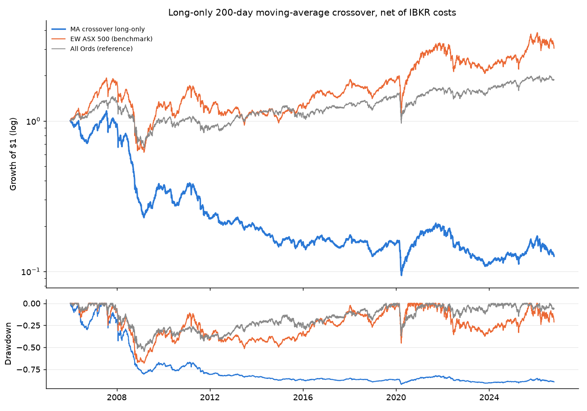
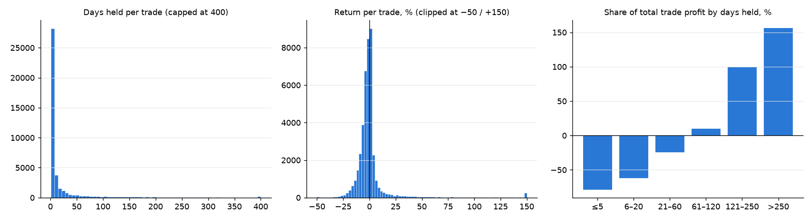
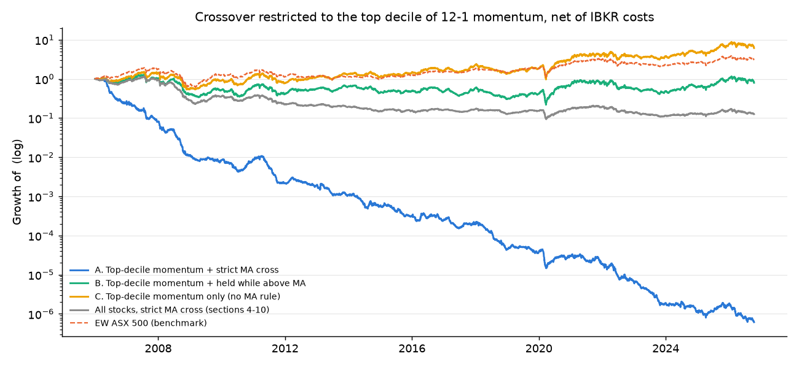

# 200-Day Moving-Average Crossover on the ASX 500

Course project (The Wall Street Quants, *Statistical Arbitrage*): research a momentum
strategy. The brief's crypto universe is swapped for Australian equities here.
The topic is a **long-only 200-day moving-average crossover** on a point-in-time ASX 500
universe: buy a stock when its close crosses from below its 200-day average to above it,
sell when it crosses back below.

The earlier Donchian channel-breakout study is in [archive_donchian/](archive_donchian/).

## Headline result

**The rule loses money.** The rule and its 200-day length were fixed in advance, so nothing
was fitted. Every figure is net of Interactive Brokers costs (0.08% commission plus half a
one-tick bid-ask spread on every trade).

| Net of IBKR costs, next-day execution | Period | Ann. ret | Ann. vol | Sharpe | Max DD | Alpha vs EW500 (t) | Costs per year |
|---|---|---|---|---|---|---|---|
| **200-day MA crossover, long-only** | 2006–16 | −14.9% | 17.5% | −0.85 | −88% | −19.6% (−7.3) | 14.4% |
| | 2017–26 | −1.1% | 16.8% | −0.07 | −48% | −8.2% (−4.0) | 12.3% |
| *Benchmark: equal-weight ASX 500 (drifting)* | 2006–16 | 5.4% | 18.3% | 0.30 | −68% | — | — |
| | 2017–26 | 9.2% | 20.3% | 0.45 | −45% | — | — |
| *Benchmark: All Ordinaries (price index)* | 2006–16 | 3.3% | 17.5% | 0.19 | −55% | — | — |
| | 2017–26 | 5.5% | 14.6% | 0.37 | −37% | — | — |

## Why it fails

* **Whipsaw.** The rule made about 41,000 trades. The median trade lasts **3 days**, and 63%
  last five days or less: a stock sitting near its average crosses it again and again.
  Only 29% of trades make money.
* **Costs.** The book turns over 12.5% of its capital a day. Commission alone would cost
  2–3% a year; the bid-ask spread adds another 10–12%.
* **No edge underneath.** Before costs, alpha against the equal-weight ASX 500 is −5.2% a
  year in 2006–16 and +4.2% in 2017–26.
* **Not the 200-day choice.** Every length from 20 to 300 days has negative alpha after
  costs in both periods ([results/08_ma_lengths.csv](results/08_ma_lengths.csv)).
* **Worse than doing nothing.** It loses to all 1,000 random buy-and-hold baskets of the
  same size, and to its own signals with the timing shuffled. The shortfall against the
  benchmark is statistically significant (p = 0.001).
* **Do not buy at the signal close.** Trading at the close that triggers the cross is far
  worse than waiting a day, even with no costs.

## Variations tested

| After IBKR costs | Ann. ret 2006–16 | Ann. ret 2017–26 | Max DD | Costs per year |
|---|---|---|---|---|
| 200-day crossover, all stocks | −14.9% | −1.1% | −92% | 12–14% |
| Whole universe, held only while the **All Ords** is above its 200-day average | 5.3% | 4.3% | −43% | 3.5–3.8% |
| Top-decile momentum + strict cross from below | −67% | −51% | −100% | 35–56% |
| Top-decile momentum + held while above the average | −3.5% | 10.3% | −83% | 10–14% |
| Top-decile momentum only, no average rule | 7.5% | 18.2% | −65% | 2–3% |

* **Index filter** (section 10): the 200-day average works better as a market-risk switch
  than as a stock signal. It cuts the drawdown from −68% to −43% at a third of the cost,
  though it earns less than buy-and-hold.
* **Momentum filter** (section 11): each quarter the tradable list is the top 10% of members
  by 12-month return, skipping the latest month. A stock leaving the list is sold; one that
  stays keeps its position.
  * With a strict cross from below the result is much worse. Winners are above their
    average 73% of the time, so only about 6 names are held and each trade reshuffles the
    book.
  * Holding the winners while they are above their average earns 15% a year before costs
    and 3% after.
  * Holding the winners with no average rule does best. The momentum filter adds value;
    the moving-average rule takes it away through trading costs.

## Data and universe

Built by [01_data_and_universe.ipynb](01_data_and_universe.ipynb):

* **Prices:** daily OHLCV from Yahoo Finance for currently listed ASX codes, 2005–2026.
  ETFs, LICs and trusts are dropped.
* **Point-in-time ASX 500:** rebuilt each month end as the top 500 stocks by 63-day median
  traded value, among stocks priced ≥ $0.10 with at least 252 days of history, applied from
  the next trading day.
* **Cleaning:** bad prints, broken adjustment factors, implausible moves and zero-volume
  days are masked.
* **Benchmarks:** an equal-weight ASX 500 built the same way as the strategy (same
  survivorship bias), and the All Ordinaries (^AORD, a price index).

## Method

* **Signal:** buy when yesterday's close was at or below the 200-day average and today's is
  above; sell on the reverse. A stock already above its average when it joins the universe
  is not bought until it crosses again.
* **Portfolio:** long-only, fully invested. A new entry gets an equal share; existing
  holdings are scaled down to make room and then drift with price. Every trade is charged.
* **Timing:** a signal at day *t*'s close is traded at day *t+1*'s close.
* **Costs:** IBKR fixed pricing for Australia, 0.08% commission plus half a one-tick spread
  (the median held name has a half-spread of 14 bps). The A$6 minimum per order is shown
  separately by account size ([results/04b_minimum_fee.csv](results/04b_minimum_fee.csv)).

## Caveats

1. **Survivorship bias.** Only today's listed companies are included, which flatters any
   long book; the benchmark has the same bias.
2. **Spread assumption.** Half of one tick per trade. Thin small caps often quote wider,
   which would make the result worse.
3. **Trimming.** Each new entry is funded by trimming every other holding. Funding entries
   from cash would trade less, but the entry and exit trades would remain.
4. **Not tested:** a band around the average, a confirmation period, weekly or monthly
   signal checks, or a two-average cross. Any of these should reduce the whipsaw.

## Reproduce

1. `01_data_and_universe.ipynb`: downloads prices (about 10 minutes the first time, cached
   in `data/`), cleans returns, builds the universe and writes `data/clean.pkl`.
2. `02_ma_crossover_research.ipynb`: the full analysis (about 5 minutes). Writes tables and
   charts to `results/`.

`us_sp1500/` and `nasdaq/` hold the data-preparation notebooks for the US universes used by
the archived study.
